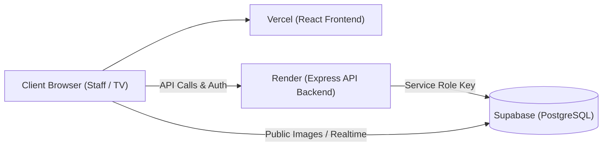

# 🚀 Deployment Guide: Frontend on Vercel & Backend on Render

This guide provides step-by-step instructions for deploying the **CofTea Cafe POS & Inventory System** with the frontend on **Vercel** and the backend API on **Render**.

---

## 🏗️ Architecture Overview

- **Frontend**: React (Vite) hosted on **Vercel** as a high-performance Single Page Application (SPA).
- **Backend**: Express (Node.js) hosted on **Render** as a Web Service.
- **Database & Storage**: Supabase (PostgreSQL + S3 Storage).

---

## Part 1: Deploy Backend to Render

### Option A: Using Render Blueprint (`render.yaml`) — Easiest
1. Push your updated code to your GitHub repository.
2. Go to your [Render Dashboard](https://dashboard.render.com).
3. Click **New +** → **Blueprint**.
4. Select your repository `INVENTORY-POS-PROJECT`.
5. Render will automatically detect `render.yaml`.
6. Fill in the required environment variables:
   - `SUPABASE_URL`: Your Supabase Project URL (`https://xxxx.supabase.co`)
   - `SUPABASE_SERVICE_ROLE_KEY`: Your Supabase service role secret key
   - `JWT_SECRET`: Leave blank for auto-generation or enter a secure 32+ character string
   - `CLIENT_URL`: Your Vercel frontend URL (you can fill this in after deploying Vercel, or set to `https://*.vercel.app`)
7. Click **Apply**. Render will build and deploy your backend.

### Option B: Manual Web Service Setup
1. On Render, click **New +** → **Web Service**.
2. Connect your GitHub repository.
3. Configure the following settings:
   - **Name**: `coftea-backend` (or your choice)
   - **Region**: Singapore (`singapore`) or closest to the Philippines
   - **Branch**: `Trying-something-wierd` (or your active branch)
   - **Root Directory**: `InventoryProject/server`
   - **Runtime**: `Node`
   - **Build Command**: `npm install`
   - **Start Command**: `node server.js`
   - **Instance Type**: `Free`
4. Expand **Advanced** and set:
   - **Health Check Path**: `/health`
5. In the **Environment Variables** tab, add:
   | Key | Value | Description |
   |---|---|---|
   | `NODE_ENV` | `production` | Production mode |
   | `PORT` | `10000` | (Render sets this automatically) |
   | `SUPABASE_URL` | `https://your-project.supabase.co` | Supabase Project URL |
   | `SUPABASE_SERVICE_ROLE_KEY` | `eyJhb...` | Supabase Service Role Key |
   | `JWT_SECRET` | *(Random 32+ char string)* | Token signing secret |
   | `CLIENT_URL` | `https://your-app.vercel.app` | Vercel production domain |
   | `GEMINI_API_KEY` | *(Optional)* | Google AI key for demand predictions |
6. Click **Create Web Service**.
7. Once deployed, copy your Render service URL (e.g. `https://coftea-backend.onrender.com`).
   - Test it by visiting `https://coftea-backend.onrender.com/health` in your browser. It should return `{"status":"ok","service":"coftea-backend",...}`.

---

## Part 2: Deploy Frontend to Vercel

1. Go to your [Vercel Dashboard](https://vercel.com/dashboard).
2. Click **Add New…** → **Project**.
3. Import your GitHub repository `INVENTORY-POS-PROJECT`.
4. In the **Configure Project** screen:
   - **Framework Preset**: `Vite`
   - **Root Directory**: Click **Edit** and choose `InventoryProject`
   - **Build Command**: `npm run build` (default)
   - **Output Directory**: `dist` (default)
   - **Install Command**: `npm install` (default)
5. Expand **Environment Variables** and add:
   | Key | Value | Notes |
   |---|---|---|
   | `VITE_API_URL` | `https://coftea-backend.onrender.com` | Your Render backend URL from Part 1 |
   | `VITE_SUPABASE_URL` | `https://your-project.supabase.co` | Supabase Project URL |
   | `VITE_SUPABASE_ANON_KEY` | `eyJhb...` | Supabase Public / Anon Key |
6. Click **Deploy**.
7. Vercel will build and deploy your app. Once finished, you will receive a production URL (e.g. `https://coftea-pos.vercel.app`).

---

## Part 3: Final Verification & CORS Sync

1. Open your Vercel deployment URL in the browser.
2. Open DevTools (F12 → Console & Network tabs).
3. Test browsing menu items, logging in via `/coftealoginpageforstaff`, and loading the dashboard.
4. If you have a custom domain on Vercel (e.g. `https://pos.cofteacafe.space`):
   - In Render, update the `CLIENT_URL` environment variable to include your custom domain.
   - Render automatically re-deploys with the updated whitelist.

---

## 💡 Troubleshooting & Render Free Tier Notes

- **Cold Starts**: Render's free tier spins down web services after 15 minutes of inactivity. When a request arrives, it may take 30–50 seconds to spin back up.
  - The frontend direct API configuration (`client.js`) waits gracefully without triggering Vercel proxy timeouts.
  - To prevent spin-downs, you can use a free uptime monitor (like UptimeRobot) pinging `https://your-backend.onrender.com/health` every 10 minutes.
- **Client IP & Rate Limiting**: The backend is configured with `app.set('trust proxy', 1)`, ensuring Render's proxy headers correctly forward the user's real IP address for audit logs and login rate limiting.
