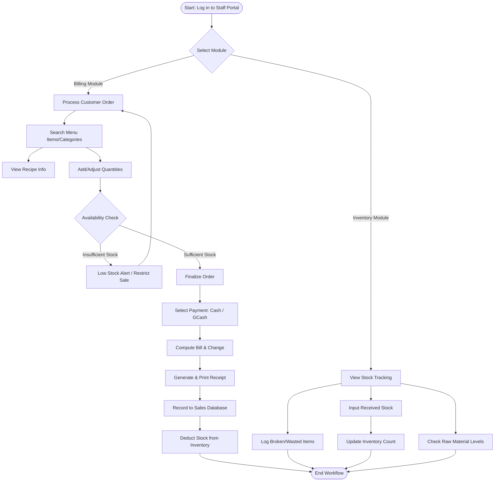
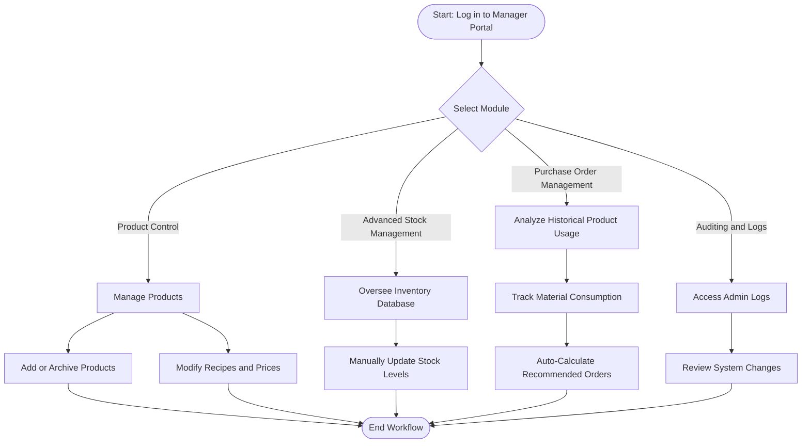
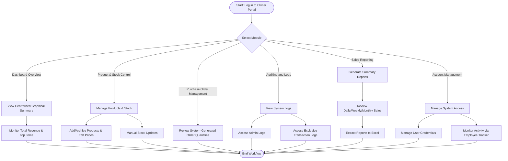

# Role Descriptions & Flowcharts for Thesis Paper

You can copy and paste the text descriptions directly into your paper. The flowcharts are written using Mermaid syntax, which you can render into images using any Markdown viewer (like the one in this interface), or online tools like [Mermaid Live Editor](https://mermaid.live/), and then insert the images into your paper.

---

## 1. Stakeholder Description: Owner

*Note: Place this in the "Who – People Involved" section alongside the Staff and Manager descriptions.*

**Owner**
The owner of Cof/Tea Cafe is an indirect stakeholder as they initiated the development of the system. They benefit from it by reviewing sales reports, analyzing business performance, and monitoring overall operations. The system provides a centralized dashboard with real-time graphical metrics, exclusive access to transaction logs, and secure Excel data extraction, providing valuable insights that support business growth and strategic decision making.

---

## 2. Staff Flowchart

### Text Description
**Staff Flowchart**
The Staff Flowchart presents the workflow of the staff when using the proposed system. It shows the different activities performed by the staff across the Billing and Inventory modules. Through the Billing Module, staff can search for items, view recipe preparation guides, process orders, and automatically compute bills and change. The system automatically performs an availability check based on raw material levels before finalizing a sale, recording the transaction, and deducting the stock. Through the Inventory Module, staff can track current stock levels, input newly received stock deliveries, log broken or wasted items, and receive real-time low-stock alerts. This workflow demonstrates how the system supports faster, more organized transactions while maintaining accurate inventory records.

### Diagram

---

## 3. Manager Flowchart

### Text Description
**Manager Flowchart**
The Manager Flowchart illustrates the workflow of the Manager in managing the proposed system. It highlights the manager's responsibilities in overseeing both product offerings and inventory operations. The manager can add or archive products, and modify specific recipes and prices through the Product Control module. The flowchart also details the Advanced Stock Management and Purchase Order Management processes, where the manager can perform manual stock updates and utilize the system's automated analysis of historical product usage to calculate and recommend precise quantities of raw materials to order. Finally, the manager can access Admin Logs to monitor system changes, ensuring smooth and efficient operational control.

### Diagram

---

## 4. Owner Flowchart

### Text Description
**Owner Flowchart**
The Owner Flowchart demonstrates the comprehensive oversight capabilities granted to the Owner within the system. The workflow begins with a Dashboard Overview that provides a centralized, real-time graphical summary of key business metrics such as total revenue, top-selling items, and low-stock warnings. In addition to full Product Control, Advanced Stock Management, and Purchase Order Management privileges, the owner has exclusive access to advanced reporting and monitoring tools. The flowchart highlights the generation of daily, weekly, and monthly Sales Summary Reports, which the owner can extract directly to Excel. It also outlines the Account Management process, allowing the owner to manage user credentials and utilize an Employee Tracker to securely monitor all system activities and transaction logs.

### Diagram

